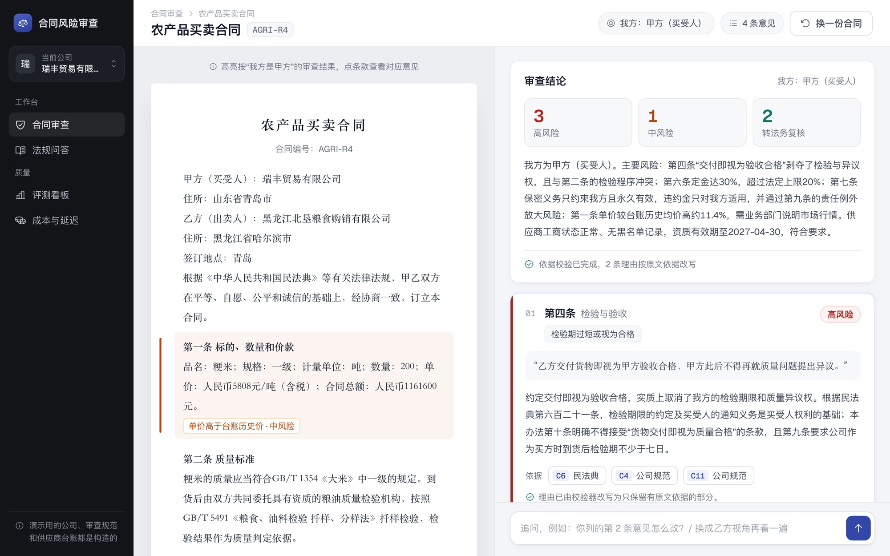

# 武敬恒 · AI 产品经理作品集

在线浏览：**https://kennywu411-dev.github.io/pm-portfolio/**

## 主案例：合同风险审查 Agent

签合同之前，帮没有专职法务的业务人员把对我方不利的条款找出来，说清楚为什么不利、依据是哪条法律或公司规定、应该怎么改；拿不准的交给法务。

| 内容 | 位置 |
|---|---|
| 作品集主页（用户与痛点、PRD 摘要、竞品、指标、评测、试用方案） | [index.html](index.html) |
| 可点击高保真原型（5 屏，带设计说明开关） | [prototype/](prototype/) |
| 每屏 PNG（2x，纯净版 + 设计说明版） | [assets/img/screens/](assets/img/screens/) |
| 可导入 Figma 的 SVG（矢量，1440 × 900） | [figma/](figma/) |
| 完整 PRD | [contract-review-agent/docs/PRD.md](https://github.com/kennywu411-dev/contract-review-agent/blob/main/docs/PRD.md) |
| 竞品分析（11 个产品） | [contract-review-agent/docs/竞品分析.md](https://github.com/kennywu411-dev/contract-review-agent/blob/main/docs/竞品分析.md) |
| 用户试用方案 | [contract-review-agent/docs/用户试用方案.md](https://github.com/kennywu411-dev/contract-review-agent/blob/main/docs/用户试用方案.md) |
| 全部数字与运行记录 | [contract-review-agent/docs/numbers.md](https://github.com/kennywu411-dev/contract-review-agent/blob/main/docs/numbers.md) |
| 项目代码 | [kennywu411-dev/contract-review-agent](https://github.com/kennywu411-dev/contract-review-agent) |



## 第二案例：DataPilot 中文问数

[kennywu411-dev/datapilot](https://github.com/kennywu411-dev/datapilot)：每个选型都做了对照实验，另有 [ROI 测算](https://github.com/kennywu411-dev/datapilot/blob/main/docs/roi.md) 和 [Bad case 复盘](https://github.com/kennywu411-dev/datapilot/blob/main/docs/badcases.md)。

## 第三案例：跨境电商经营分析看板

[在线看板](https://kennywu411-dev.github.io/ecommerce-dashboard/) · [仓库](https://github.com/kennywu411-dev/ecommerce-dashboard)：用 UCI 公开数据先写指标定义，再从经营问题推出 5 页看板。

## 关于原型里的内容

- 合同、审查意见、追问回答都取自项目的真实运行记录（构造评测集里的 AGRI-R4、GOODS-R3），没有为原型编写新的“理想输出”。
- 演示用的三家公司、审查规范和供应商台账都是构造的。
- 依据原文只展示《民法典》条文和构造的公司规范。官方合同示范文本的网站只写了“版权所有”，所以本仓库不包含示范文本原文。
- 所有评测数字来自构造数据，不是真实用户或上线数据。真实用户试用的结果出来后再更新。

## 重新导出截图

```bash
bash scripts/export.sh
```

需要 Google Chrome 和 poppler（`pdftocairo`）。SVG 由 Chrome 打印成 PDF 后转换，文字已转成矢量轮廓，Figma 里拖入即可作为图层编辑。

## 第三方资源

- 字体 [Geist](https://github.com/vercel/geist-font)：SIL Open Font License 1.1，见 [assets/fonts/Geist-OFL.txt](assets/fonts/Geist-OFL.txt)
- 图标 [Phosphor Icons](https://github.com/phosphor-icons/web)：MIT License，见 [assets/vendor/phosphor/LICENSE](assets/vendor/phosphor/LICENSE)
