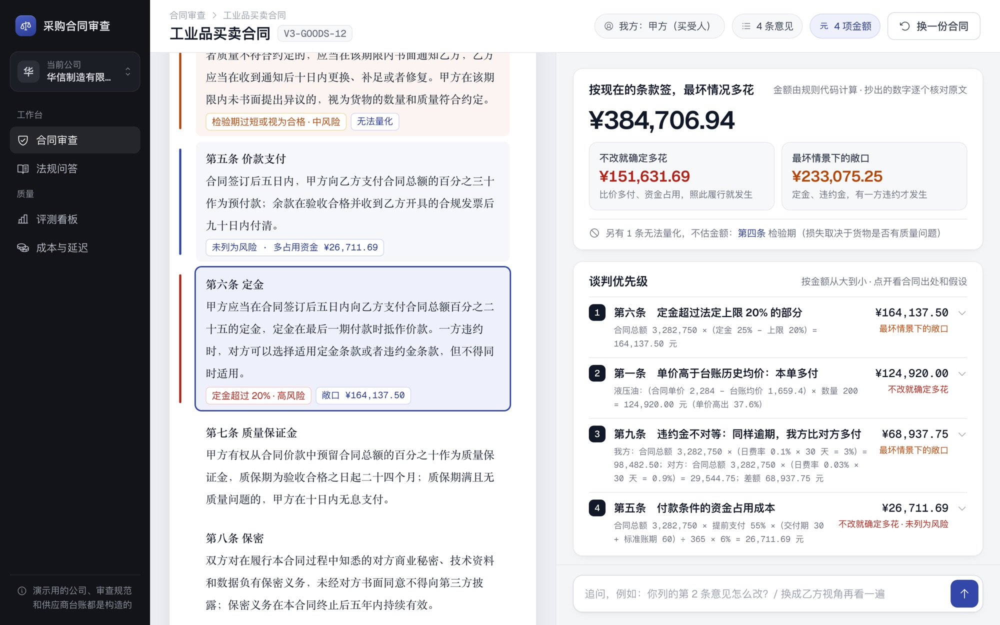

# 武敬恒 · AI 产品经理作品集

在线浏览：**https://kennywu411-dev.github.io/pm-portfolio/**

## 主案例：采购合同审查 Agent：把每条风险算成钱

签采购合同之前，帮没有专职法务的中小企业采购把对我方不利的条款找出来，给出可直接替换的改法和法条原文，并把每条能算的风险换算成金额、按金额排出谈判优先级。金额由规则代码计算，带算式和合同出处；算不了的标“无法量化”，拿不准的交给法务。

在线回放：<https://kennywu411-dev.github.io/contract-review-agent/>

| 内容 | 位置 |
|---|---|
| 作品集主页（用户与痛点、产品方案、PRD 摘要、竞品、指标、评测、试用方案） | [index.html](index.html) |
| 可点击高保真原型（6 屏，带设计说明开关） | [prototype/](prototype/) |
| 每屏 PNG（2x，纯净版 + 设计说明版） | [assets/img/screens/](assets/img/screens/) |
| 可导入 Figma 的 SVG（矢量，1440 × 900） | [figma/](figma/) |
| 完整 PRD | [contract-review-agent/docs/PRD.md](https://github.com/kennywu411-dev/contract-review-agent/blob/main/docs/PRD.md) |
| 竞品分析（11 个产品） | [contract-review-agent/docs/竞品分析.md](https://github.com/kennywu411-dev/contract-review-agent/blob/main/docs/竞品分析.md) |
| 金额测算的设计与评测（ADR 014） | [contract-review-agent/docs/adr/014-金额测算.md](https://github.com/kennywu411-dev/contract-review-agent/blob/main/docs/adr/014-金额测算.md) |
| 用户试用方案 | [contract-review-agent/docs/用户试用方案.md](https://github.com/kennywu411-dev/contract-review-agent/blob/main/docs/用户试用方案.md) |
| 全部数字与运行记录 | [contract-review-agent/docs/numbers.md](https://github.com/kennywu411-dev/contract-review-agent/blob/main/docs/numbers.md) |
| 项目代码 | [kennywu411-dev/contract-review-agent](https://github.com/kennywu411-dev/contract-review-agent) |



## 第二案例：MetricLens 经营问数与指标异动归因

[在线回放](https://kennywu411-dev.github.io/metriclens/) · [kennywu411-dev/metriclens](https://github.com/kennywu411-dev/metriclens)：能问“是多少”，也能问“为什么变了”。归因的拆解由 SQL 和代码完成，回答里的数字逐个核对；找不到突出原因时明说。每个选型都做了对照实验，见 [归因设计（ADR 007）](https://github.com/kennywu411-dev/metriclens/blob/main/docs/adr/007-指标异动归因.md)、[ROI 测算](https://github.com/kennywu411-dev/metriclens/blob/main/docs/roi.md) 和 [Bad case 复盘](https://github.com/kennywu411-dev/metriclens/blob/main/docs/badcases.md)。

## 第三案例：跨境电商经营分析看板

[在线看板](https://kennywu411-dev.github.io/ecommerce-dashboard/) · [仓库](https://github.com/kennywu411-dev/ecommerce-dashboard)：用 UCI 公开数据先写指标定义，再从经营问题推出 5 页看板。

## 关于原型里的内容

- 合同、审查意见、追问回答、金额都取自项目的真实运行记录（构造评测集里的 AGRI-R4、GOODS-R3、V3-GOODS-12），没有为原型编写新的“理想输出”。
- AGRI-R4 的运行记录早于金额测算，所以第 3 到 5 屏没有金额；金额与谈判优先级在第 6 屏，用的是 V3-GOODS-12，和在线回放页是同一份输出。
- 演示用的三家公司、审查规范和供应商台账都是构造的。
- 依据原文只展示《民法典》条文和构造的公司规范。官方合同示范文本的网站只写了“版权所有”，所以本仓库不包含示范文本原文。
- 所有评测数字来自构造数据，不是真实用户或上线数据。真实用户试用目前只有方案，没有执行。

## 重新导出截图

```bash
bash scripts/export.sh
```

需要 Google Chrome、poppler（`pdftocairo`）和 macOS 自带的 `sips`（生成主页用的压缩图）。SVG 由 Chrome 打印成 PDF 后转换，文字已转成矢量轮廓，Figma 里拖入即可作为图层编辑。

## 第三方资源

- 字体 [Geist](https://github.com/vercel/geist-font)：SIL Open Font License 1.1，见 [assets/fonts/Geist-OFL.txt](assets/fonts/Geist-OFL.txt)
- 图标 [Phosphor Icons](https://github.com/phosphor-icons/web)：MIT License，见 [assets/vendor/phosphor/LICENSE](assets/vendor/phosphor/LICENSE)
